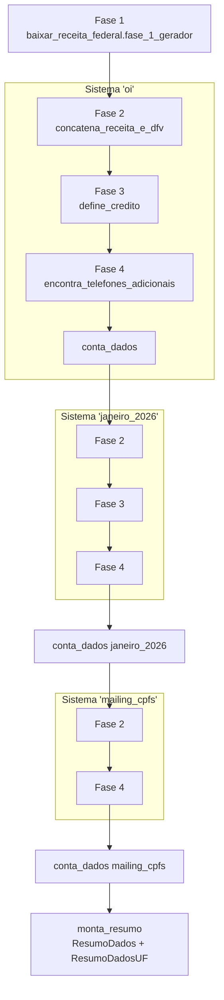

# Gerador de Mailings — Receita Federal × DFV

Sistema em Python/Django que monta **mailings de prospecção** de empresas (CNPJ) e pessoas físicas (CPF). Ele cruza a base pública de CNPJs da Receita Federal com os arquivos de cobertura de rede da operadora (**DFV**), classifica cada endereço por **viabilidade técnica**, anexa a situação de **crédito**, **enriquece os telefones** a partir de uma base própria e entrega arquivos filtrados (blacklist, quarentena, telefones já discados) nos formatos dos discadores (**IPBOX**, **VONIX** ou padrão).

---

## Sumário

- [Visão geral do pipeline](#visão-geral-do-pipeline)
- [Sistemas (clientes/campanhas)](#sistemas-clientescampanhas)
- [Estrutura dos módulos](#estrutura-dos-módulos)
- [Fase 1 — Download e carga da Receita Federal](#fase-1--download-e-carga-da-receita-federal)
- [Fase 2 — Viabilidade (Receita × DFV)](#fase-2--viabilidade-receita--dfv)
- [Fase 3 — Crédito](#fase-3--crédito)
- [Fase 4 — Enriquecimento de telefones](#fase-4--enriquecimento-de-telefones)
- [Finalização: métricas e resumo](#finalização-métricas-e-resumo)
- [Extração de mailings e ferramentas avulsas](#extração-de-mailings-e-ferramentas-avulsas)
- [Bases externas (MySQL)](#bases-externas-mysql)
- [Arquivos de entrada (uploads) e validações](#arquivos-de-entrada-uploads-e-validações)
- [Estrutura de pastas](#estrutura-de-pastas)
- [Modelos Django utilizados](#modelos-django-utilizados)
- [Instalação e configuração](#instalação-e-configuração)
- [Como executar](#como-executar)
- [Regras de negócio de telefone](#regras-de-negócio-de-telefone)
- [Pontos de atenção conhecidos](#pontos-de-atenção-conhecidos)

---

## Visão geral do pipeline

O ponto de entrada é `functions/gerador.py → inicia_gerador()`.



Cada fase registra o andamento em `Status_Execucoe_DB` via `salva_status(...)` (status `Em Andamento`, `Concluido` ou `Erro`). Cada fase tem também uma função `verificador_fase_N` que confere os arquivos gerados antes de liberar a próxima.

> O sistema `giga_mais` tem suporte nas fases 2 e 4, mas **não** é chamado por `inicia_gerador()`. É preciso acioná-lo separadamente.

---

## Sistemas (clientes/campanhas)

Definidos em `functions/contantes.py → PASTAS_RAIZ`:

| Sistema        | Pasta raiz            | Fonte de registros                     | Fases       | Saídas de viabilidade        |
|----------------|-----------------------|----------------------------------------|-------------|------------------------------|
| `oi`           | `media/`              | Receita Federal (CNPJ)                 | 1 → 2 → 3 → 4 | Primária e Secundária        |
| `janeiro_2026` (alias `mailing_2026`) | `media_janeiro_2026/` | Receita Federal (CNPJ)  | 2 → 3 → 4   | Primária e Secundária        |
| `giga_mais`    | `media_giga_mais/`    | Receita Federal (CNPJ)                 | 2 → 4       | Somente Primária             |
| `mailing_cpfs` | `media_mailing_cpf/`  | Arquivos de CPF (externo e Credlink)   | 2 → 4       | Primária e Secundária        |

---

## Estrutura dos módulos

```
functions/
├── gerador.py                        # Orquestrador: inicia_gerador(), monta_resumo()
├── baixar_receita_federal.py         # Fase 1: download, unificação e carga da Receita
├── concatena_receita_e_dfv.py        # Fase 2: cruzamento Receita × DFV (viabilidade)
├── define_credito.py                 # Fase 3: crédito (arquivo + banco)
├── encontra_telefones_adicionais.py  # Fase 4: enriquecimento de telefones
├── finaliza_analise_de_dados.py      # Métricas por estado/viabilidade/crédito (DadoExtracao)
├── utils.py                          # Telefones, blacklist, quarentena, filtros, extração, validação de uploads
├── contantes.py                      # ESTADOS_BR, DTYPES_RECEITA_FEDERAL, PASTAS_RAIZ, listas de municípios
├── importa_dados_telefones.py        # Importa chamadas discadas (MySQL externo 1)
├── pesquisa_operadora.py             # Consulta operadora/portabilidade (MySQL externo 2)
└── checa_viabilidades_manualmente.py # Script avulso: classifica um mailing qualquer contra um DFV
```

### `contantes.py`

| Constante                  | Conteúdo |
|----------------------------|----------|
| `ESTADOS_BR`               | As 27 UFs. |
| `DTYPES_RECEITA_FEDERAL`   | dtypes do CSV unificado da Receita (25 colunas). |
| `PASTAS_RAIZ`              | Sistema → pasta raiz (tabela acima). |
| `LISTA_ESTADOS_MUNICIPIOS` / `DICT_ESTADOS_MUNICIPIOS` | Municípios por UF (arquivo de ~5,6 mil linhas). Não são usados pelos demais módulos documentados aqui. |

---

## Fase 1 — Download e carga da Receita Federal

**Arquivo:** `baixar_receita_federal.py` · **Entrada:** `fase_1_gerador()` (decorada com `@fecha_conexoes`)

1. **Limpeza**: apaga a tabela `Log` e esvazia `media/arquivos_receita_federal/`.
2. **Download** (`baixa_arquivos_receita`):
   - `descobrir_mes_disponivel` testa o mês atual e até 2 meses para trás no endpoint público `arquivos.receitafederal.gov.br/.../{AAAA-MM}/Cnaes.zip`.
   - Baixa 37 ZIPs: `Cnaes`, `Empresas0-9`, `Estabelecimentos0-9`, `Motivos`, `Municipios`, `Naturezas`, `Paises`, `Qualificacoes`, `Simples`, `Socios0-9`.
   - `baixar_arquivo` grava em `.part`, confere os bytes contra o `Content-Length`, retoma com `Range` se a conexão cair, valida que o resultado é um ZIP e só então renomeia. São até 8 tentativas, além do retry da sessão HTTP (429/5xx).
3. **Extração** (`extrair_zip_e_renomear`): cada ZIP vai para uma subpasta (`cnaes/`, `empresa/`, `estabelecimentos/`, …) com nome padronizado.
4. **Tabelas de apoio** (`salvar_infos_base`): faz upsert de `Cnae`, `NaturezaJuridica` e `Municipio`. A UF de cada município é deduzida dos estabelecimentos.
5. **Unificação** (`unifica_dados`):
   - Monta um bitmap NumPy de 100 milhões de posições com os `cnpj_basico` **ativos** (`situacao_cadastral == 2`).
   - Para cada chunk de estabelecimentos ativos, faz merge com Empresas, Simples, Natureza Jurídica, CNAE, Municípios e Sócios.
   - Gera os campos derivados:
     - `cnpj` (básico + ordem + DV, depois mascarado `00.000.000/0000-00`)
     - `TEL1`, `TEL2`, `TEL3` (DDD + número; TEL3 vem do fax)
     - `decisor` (sócio → representante → nome após o CPF na razão social de MEI)
     - `logradouro` (tipo de logradouro normalizado + nome)
     - `CPF` (extraído do final da razão social/decisor, quando houver 11 dígitos)
     - `MEINAOMEI` (opção MEI do Simples, ajustada por heurística: LTDA → N, natureza 2135 → S, nome terminando em ≥7 dígitos → S)
   - Grava `media/arquivos_receita_federal/{UF}.csv` e depois remove CNPJs duplicados.
   - Gera os **clusters no formato OI** (`media/arquivos_formato_oi/cluster_1..4.csv` + `.zip`) e `media/dados_cnaes.csv` (lista "código - descrição" usada nos filtros).
6. **Carga no banco** (`cadastra_atualiza_empresas`): faz upsert de `Empresa` por `cnpj` em lotes de 10 mil. Ao final, **apaga as empresas que não foram atualizadas nesta carga** (ficaram inativas).
7. **Limpeza** das subpastas brutas (`realiza_limpeza`) e verificação (`verificador_fase_1`), que confere se cada `{UF}.csv` foi criado hoje, tem exatamente as 25 colunas esperadas e não tem CNPJ repetido.
8. Sempre compacta a pasta em `media/arquivos_receita_federal.zip`.

**Colunas do CSV unificado** (`lista_col`):
`data_inicio_atividades, natureza_juridica, descricaonj, cnae_fiscal, cnae_fiscal_secundaria, descricaocf, cnpj, razao_social, nome_fantasia, matriz_filial, decisor, situacao_cadastral, correio_eletronico, logradouro, num_fachada, complemento1, bairro, cep, municipio, uf, CPF, MEINAOMEI, TEL1, TEL2, TEL3`

> ⚠️ É uma etapa pesada de memória. O próprio código registra cerca de 13 GB só para o DataFrame de empresas.

---

## Fase 2 — Viabilidade (Receita × DFV)

**Arquivo:** `concatena_receita_e_dfv.py` · **Entrada:** `fase_2_concatenador(sistema, nova_execucao)`

A fase tem duas partes:

1. **`fase_2_concatenador_DB`** roda sempre, para qualquer sistema. Atualiza `Empresa.viabilidade` no banco, estado por estado, numa transação: zera o campo e grava `VIABILIDADE_PRIMARIA` ou `VIABILIDADE_SECUNDARIA` em lotes de 5 mil IDs.
2. **Geração de arquivos por sistema**: grava `Viabilidade_Primaria_{UF}.csv` e `Viabilidade_Secundaria_{UF}.csv` em `<pasta_raiz>/viabilidades/`.

### Chaves de cruzamento (`gera_campos_cep`)

| Chave              | Composição                                   | Quando é válida |
|--------------------|----------------------------------------------|-----------------|
| `CHAVE_ESPECIFICA` | `cep \| discriminador` (número da fachada; em DF/GO, o lote do complemento) | CEP **específico** (não termina em `000`) |
| `CHAVE_GERAL`      | `cep \| hash(logradouro) \| número`          | CEP **genérico** (termina em `000`) |

Chave vazia significa chave inválida. Antes do cruzamento, a versão do banco normaliza os campos com `padroniza()`:

- `normaliza_cep`: só dígitos, 8 posições.
- `normaliza_numero`: primeiro grupo numérico, sem zeros à esquerda (`"123/125"` → `123`, `"S/N"` → vazio).
- `normaliza_logradouro`: remove acentos e stopwords, expande abreviações (`AV`, `PRES`, `DR`…) e numerais (`7` → `SETE`) e ordena os tokens, para ficar imune à ordem das palavras.
- `normaliza_complemento`: `"LJ 2"` → `LOJA2`, `"AP 301"` → `APTO301`.

### Regras de classificação

| Classificação   | Regra |
|-----------------|-------|
| **Primária**    | `CHAVE_ESPECIFICA` bate com o DFV **ou** `CHAVE_GERAL` bate com o DFV. |
| **Secundária**  | Não é primária, o CEP está entre os CEPs **específicos** do DFV **e** o complemento não indica unidade interna (`apto`, `apartamento`, `sala`, `bloco`; na versão do banco também `conjunto` e `andar`). |
| **Não viável**  | Nenhum dos casos acima. |

Filtros do DFV: só entram linhas com `HP_LIVRE >= 1` (portas livres) nos sistemas `oi` e `mailing_cpfs`.

**DF e GO** usam o **lote** (no complemento) como discriminador, em vez do número da fachada: `COMPLEMENTO1` no DF e `COMPLEMENTO2` em GO.

### Particularidades por sistema

| Sistema        | DFV lido de | Colunas de DFV usadas | Observações |
|----------------|-------------|-----------------------|-------------|
| `oi`           | `media/arquivos_dfv/` (arquivos cujo nome contém a UF) | `CEP`, `NO_FACHADA`, `LOGRADOURO`, `HP_LIVRE`, `COMPLEMENTO1/2` | Primária + Secundária. |
| `giga_mais`    | `media_giga_mais/arquivos_dfv/` (todos) | `CEP` | Primária = CEP específico presente no DFV + complemento sem unidade interna. Não gera Secundária. |
| `janeiro_2026` | `media_janeiro_2026/arquivos_dfv/` | `CEP`, `FACHADA`, `ENDERECO` | Sem filtro de `HP_LIVRE`. Erro se faltar DFV de algum estado. |
| `mailing_cpfs` | `media/arquivos_dfv/` (mesmo DFV da OI) | idem `oi` | Lê CPFs de `arquivos_cpf_externo/` e `arquivos_cpf_credlink/` em chunks de 1 milhão. A coluna `pasta` indica a origem. Cria arquivos só com cabeçalho para UFs sem resultado. |

Os verificadores (`verificador_fase_2` e `verificador_fase_2_cpf`) conferem se os arquivos têm menos de 24 h e as colunas esperadas, e se não há CNPJ repetido dentro de um arquivo nem entre arquivos.

---

## Fase 3 — Crédito

**Arquivo:** `define_credito.py` · **Entrada:** `fase_3_define_credito(nova_execucao, sistema)`

Fonte: `media/arquivos_credito/credito.csv` (colunas `CNPJ`, `APROVADO/NEGADO`, `LETRAS_STATUS`), consolidado previamente por `utils.gera_e_atualiza_dados_credito_turbo`.

1. Descarta as linhas cujo `LETRAS_STATUS` contém **"k"**.
2. `APROVADO/NEGADO == "S"` → **Aprovado**; qualquer outro valor → **Negado**. CNPJ ausente → **Sem Infos**. Se o mesmo CNPJ aparecer como aprovado e negado, **Negado prevalece**.
3. Adiciona a coluna `credito` em cada arquivo de viabilidade e grava em `<raiz>/viabilidades_credito/`.
4. `verificador_fase_3` chama **`fase_3_define_credito_DB`**, que, numa transação, zera `Empresa.credito` e grava `CREDITO_APROVADO` ou `CREDITO_NEGADO` em lotes. Busca o CNPJ com e sem máscara. Se o arquivo de crédito estiver ausente, vazio ou sem colunas, aborta **antes** de zerar o banco.
5. Depois valida os arquivos: devem ter sido criados hoje, ter as colunas esperadas, não ter CNPJ repetido e ter exatamente 3 valores de crédito.

---

## Fase 4 — Enriquecimento de telefones

**Arquivo:** `encontra_telefones_adicionais.py` · **Entrada:** `fase_4_enriquecer(sistema, nova_execucao)`

1. Carrega toda a tabela `Telefones` em memória como `{documento: [telefones]}`. **Aborta se houver menos de 1 milhão de documentos**, como proteção contra base incompleta.
2. Para cada arquivo de viabilidade (`viabilidades_credito/`; no `giga_mais` e no `mailing_cpfs`, `viabilidades/`):
   - Limpa e deduplica os telefones originais (`TEL1-3` ou `celular_1-3`).
   - Adiciona até **20 telefones** da base em `Telefone_1 … Telefone_20`.
   - **Cada telefone aparece uma única vez em todo o conjunto de arquivos.** Os telefones originais têm prioridade sobre os da base.
   - Remove as colunas `CHAVE_ESPECIFICA` e `CHAVE_GERAL`.
3. Grava em `<raiz>/viabilidades_credito_enriquecido/` e valida com `verificador_fase_4` (CNPJ) ou `verificador_fase_4_cpfs` (CPF).

---

## Finalização: métricas e resumo

- **`finaliza_analise_de_dados.conta_dados(sistema)`**: apaga os `DadoExtracao` do dia para o sistema e grava contagens:
  - empresas ativas por UF (total, MEI e não-MEI);
  - quantidade por tipo de viabilidade e UF;
  - CNPJs aprovados, negados e sem informação, separados entre MEI e não-MEI.
- **`gerador.monta_resumo()`**: cria um `ResumoDados` com os totais gerais e um `ResumoDadosUF` por UF, a partir de agregações em `Empresa` (MEI/não-MEI × viabilidade × crédito). Usa só 2 queries de leitura.

---

## Extração de mailings e ferramentas avulsas

Funções de `utils.py` chamadas pelas views:

### Extração

| Função | Descrição |
|--------|-----------|
| `get_dados_mailing(colunas_filtro, ...)` | Lê os arquivos enriquecidos das UFs pedidas (4 threads, chunks de 1 milhão). Filtros: qualquer coluna, `cnae_fiscal` (aceita `"código - descrição"`), `termos_chave` (busca em razão social e nome fantasia) e `MEINAOMEI`. Opções: `tipoMailing` (`primario`/`secundario`/`ambos`), `conjunto_telefones` (`todos`/`apenas_original`), `tipos_telefone` (`todos`/`apenas_movel`/`apenas_fixos`), `filtro_telefone_blacklist`, `coletar_atendidos`/`coletar_nao_atendidos`/`coletar_novos` e `formato_saida` (`padrao`, `IPBOX` com DDD1..8/TEL1..8, `VONIX` com TELEFONE1..8 e ORIGEM MEI/NMEI). |
| `get_dados_mailing_cpf(...)` | Equivalente para o mailing de CPFs (somente celulares). |
| `get_dados_csv(colunas_filtro, campos_retorno)` | Consulta direta aos CSVs da Receita. |
| `get_infos_cnpj(cnpj, estado)` | Ficha de um CNPJ com crédito e tipo de viabilidade. |
| `get_municipios_estado(uf)` / `get_cnaes()` | Listas para os filtros da interface. |

### Bases auxiliares (atualizadas por upload)

| Função | O que faz |
|--------|-----------|
| `ler_arquivos_e_coletar_telefones(sistema)` | Junta os telefones de `media/arquivos_blacklist/` e, só no sistema `oi`, de `media/arquivos_tels_next/`. |
| `gera_e_atualiza_quarentena(raiz, db)` | Incorpora arquivos de perfilamento (`telefone`, `data`, `tempo quarentena em dias`) e arquivos "tels next" (`numero_chamado`, quarentena fixa de **160 dias**) em `arquivos_quarentena/quarentena.csv`. |
| `analisa_quarentena(raiz)` | Remove do `quarentena.csv` os telefones com quarentena vencida e devolve os vigentes. |
| `gera_e_atualiza_enriquecimento()` | Importa `media/arquivos_enriquecimento/` para a tabela `Telefones` (upsert por telefone). Detecta sozinho a coluna de documento e as de telefone, inclusive no formato `ddd1 + tel1`. |
| `gera_e_atualiza_dados_credito_turbo(raiz)` | Consolida os novos arquivos de crédito em `credito.csv` em paralelo (`ProcessPoolExecutor`). O dado mais novo prevalece. |

### Ferramentas sobre arquivos do usuário (devolvem um `.zip`)

| Função | Resultado |
|--------|-----------|
| `filtra_arquivos` | Remove telefones em blacklist ou quarentena e repetidos. Separa os registros sem contato em `sem_contato*`. Aceita formato IPBOX (`DDD1..6`/`TEL1..6`) ou geral (colunas com `tel`). |
| `complementa_arquivos` | Acrescenta até 20 telefones da base `Telefones` por CNPJ. |
| `complementa_cnpj` | Completa um arquivo com os dados cadastrais da Receita, inclusive CNAEs secundários, sem perder linhas. |
| `classifica_telefones` | Coluna `classificacao`: `NOVO`, `ATENDIDO` ou `NAO ATENDIDO` (a partir de `TelefonesDiscados`). |
| `classifica_operadoras` | Coluna `operadora` via `pesquisa_operadora.consulta_operadora_lote`. |

### `checa_viabilidades_manualmente.py`

Script independente, sem Django, para classificar **qualquer mailing** (CSV/TXT/XLS/XLSX) contra um DFV (arquivo ou pasta), **sem remover linhas**. Ele só adiciona a coluna `VIABILIDADE`.

```python
from checa_viabilidades_manualmente import classifica_viabilidade_arquivo

df = classifica_viabilidade_arquivo(
    "base_ES.csv", "DFV_ES.xlsx",
    caminho_saida="saida/base_ES_classificada.csv",
)
print(df["VIABILIDADE"].value_counts())
```

> Ele usa uma versão **antiga** de `gera_campos_cep` (chave sem separador, últimos 3 caracteres do logradouro). Os resultados podem divergir da Fase 2 atual.

---

## Bases externas (MySQL)

### `importa_dados_telefones.py` — histórico de chamadas (`EXTERNAL_1_DB_*`)

Lê a tabela `chamadas` (`dst_clean`, `hangup_desc`, `calldate`) dia a dia e popula `TelefonesDiscados`:

- `cadastra_telefones_dia()`: ontem e hoje. É a rotina diária.
- `cadastra_telefones_antigos()`: últimos 90 dias. Serve para carga inicial ou reprocessamento.
- Regras (`_processa_dia`): uma chamada é sucesso quando `hangup_desc` contém `"200 - OK"`. Dentro do dia, o sucesso prevalece e, no empate, fica o registro mais antigo. Entre dias, um sucesso posterior atualiza **só** `sucesso_chamada`, preservando a data original. Falhas em telefones já cadastrados são ignoradas.
- Os registros com mais de 90 dias são apagados.
- Também tem `pesquisa_telefones(termo, dias, apenas_sucesso, limite)` (busca parcial por `LIKE`) e `relatorio_ligacoes(dias)`/`imprime_relatorio(dias)` (ligações, telefones distintos e novos por dia).

### `pesquisa_operadora.py` — operadora e portabilidade (`EXTERNAL_2_DB_*`)

`consulta_operadora(telefone)` segue esta ordem:

1. `number_route_1` (números **portados**), pela coluna `tn`;
2. `stfc_cadup` (não portados), por `cn` (DDD), `prefixo` e faixa;
3. com o `rn1` encontrado, busca o nome em `vi_rn1`.

O de-para `rn1 → prestadora` fica em cache na memória por 24 h, de forma thread-safe (`carrega_cache_rn1`). Há também uma conexão persistente por thread para o Gunicorn (`get_conn_persistente`), consulta em lote (`consulta_operadora_lote`) e consulta a partir de um arquivo texto (`consulta_operadora_arquivo`).

---

## Arquivos de entrada (uploads) e validações

`utils.verifica_arquivo(...)` valida as primeiras linhas (300; 50 mil no crédito) e encaminha para o validador da pasta de destino. Arquivo inválido é apagado.

| Pasta de upload           | Extensões aceitas | Requisitos |
|---------------------------|-------------------|------------|
| `arquivos_dfv`            | xls, xlsx, xlsb   | **oi:** `UF, MUNICIPIO, LOCALIDADE, BAIRRO, LOGRADOURO, CEP, CELULA, TIPO_CDO, COMPLEMENTO2, COMPLEMENTO3, CODIGO_LOGRADOURO, NO_FACHADA, COMPLEMENTO1, VIABILIDADE_ATUAL, HP_TOTAL, HP_LIVRE, OPB_CEL, DT_ATUALIZACAO` · **giga_mais:** `TERRITÓRIO, CIDADE, ESTADO, LOGRADOURO, CEP, BAIRRO` · **janeiro_2026:** `ENDERECO, FACHADA, CEP` |
| `arquivos_credito`        | csv, txt, xlsx    | `CNPJ`, `APROVADO/NEGADO` (`S`/`N`), `LETRAS_STATUS`. Aceita aliases: `APROVACAO_CREDITO`, `CREDITO_PREAPROVADO`, `APROVADO`, `LETRA_MOTIVO_NEGATIVA`, `LETRA_MOTIVO_NEGACAO`, `COD_MAILING`. |
| `arquivos_enriquecimento` | csv, txt, xls, xlsx, xlsb | Uma coluna de documento (`cpf`/`cnpj`/`documento`) e colunas de telefone (`tel`/`celular`/`fixo`). |
| `arquivos_quarentena`     | csv, txt, xls, xlsx, xlsb | `telefone`, `data` (dd/mm/aaaa ou aaaa-mm-dd) e `tempo quarentena em dias` (numérico). |
| `arquivos_blacklist`      | csv, txt, xls, xlsx, xlsb ou lista em texto | Colunas com `telefone` ou `ddd`. |
| `arquivos_filtragem`      | csv, txt, xls, xlsx, xlsb | IPBOX (`DDD1..6` + `TEL1..6`) ou coluna com `telefone`. |
| `arquivos_complementar`   | csv, txt, xls, xlsx, xlsb | Coluna `cnpj`. |
| `arquivos_cpf_externo` / `arquivos_cpf_credlink` | csv | `cpf, nome, endereco, numero, complemento, cep, bairro, cidade, uf, celular_1..3, renda_presumida` (aceita `ddd1+tel1` e `logradouro` como `endereco`). |

---

## Estrutura de pastas

Todos os caminhos são relativos a `os.getcwd()`. **Execute a partir da raiz do projeto.**

```
media/
├── arquivos_receita_federal/        # {UF}.csv unificados (Fase 1)
├── arquivos_receita_federal.zip
├── arquivos_formato_oi/             # cluster_1..4.csv
├── arquivos_formato_oi.zip
├── dados_cnaes.csv                  # "código - descrição" para filtros
├── arquivos_dfv/                    # DFV da OI (também usado pelo mailing de CPFs)
├── arquivos_credito/credito.csv     # base consolidada de crédito
├── arquivos_blacklist/
├── arquivos_tels_next/
├── arquivos_quarentena/quarentena.csv
├── arquivos_enriquecimento/         # uploads temporários (apagados após importar)
├── viabilidades/                    # Fase 2
├── viabilidades_credito/            # Fase 3
└── viabilidades_credito_enriquecido/# Fase 4 (arquivos finais)

media_janeiro_2026/   arquivos_dfv/ viabilidades/ viabilidades_credito/ viabilidades_credito_enriquecido/
media_giga_mais/      arquivos_dfv/ viabilidades/ viabilidades_credito_enriquecido/
media_mailing_cpf/    arquivos_cpf_externo/ arquivos_cpf_credlink/ viabilidades/ viabilidades_credito_enriquecido/
```

Padrão de nome dos arquivos de viabilidade: `Viabilidade_{Primaria|Secundaria}_{UF}.csv`, separador `;`.

---

## Modelos Django utilizados

Os modelos ficam fora destes módulos. Abaixo está o que o código espera deles.

| App        | Modelo / função | Uso |
|------------|-----------------|-----|
| `data`     | `Status_Execucoe_DB`, `salva_status()` | Acompanhamento das execuções. |
| `data`     | `Log`, `salva_log()` | Log técnico (apagado no início da Fase 1). |
| `data`     | `DadoExtracao`, `salva_dado()` | Métricas por sistema e dia. |
| `data`     | `TelefonesDiscados` | `telefone` (único), `sucesso_chamada`, `momento_chamada`. |
| `corpdata` | `Empresa` | `cnpj` (único), dados cadastrais, `municipio` (FK), `natureza_juridica` (FK), `cnae_fiscal` (FK), `cnaes_secundarios` (M2M), `eh_mei`, `telefone_receita_1..3`, `viabilidade`, `credito`, `atualizado_em`. Constantes: `VIABILIDADE_PRIMARIA`, `VIABILIDADE_SECUNDARIA`, `CREDITO_APROVADO`, `CREDITO_NEGADO`. |
| `corpdata` | `Cnae`, `NaturezaJuridica`, `Municipio` (`codigo`, `nome`, `uf`) | Tabelas de domínio. |
| `corpdata` | `Telefones` | `documento`, `telefone` (único). Base de enriquecimento. |
| `corpdata` | `ResumoDados`, `ResumoDadosUF` | Painel de totais. |

---

## Instalação e configuração

### Dependências Python

```
django
pandas
numpy
requests
urllib3
beautifulsoup4
python-dateutil
unidecode
chardet
pytz
pymysql
python-dotenv
openpyxl      # leitura de .xlsx
pyxlsb        # leitura de .xlsb (DFV)
```

### Variáveis de ambiente (`.env`)

```dotenv
# Base de chamadas (importa_dados_telefones.py)
EXTERNAL_1_DB_HOST=
EXTERNAL_1_DB_PORT=3306
EXTERNAL_1_DB_USER=
EXTERNAL_1_DB_PASSWORD=
EXTERNAL_1_DB_NAME=

# Base de portabilidade/operadoras (pesquisa_operadora.py)
EXTERNAL_2_DB_HOST=
EXTERNAL_2_DB_PORT=3306
EXTERNAL_2_DB_USER=
EXTERNAL_2_DB_PASSWORD=
EXTERNAL_2_DB_NAME=
```

### Requisitos de máquina

- **RAM**: dezenas de GB. A Fase 1 mantém em memória empresas, sócios e simples do Brasil inteiro, e a Fase 4 carrega a tabela `Telefones` inteira.
- **Disco**: espaço para os ZIPs da Receita, os arquivos extraídos e os CSVs por UF.
- Acesso HTTPS a `arquivos.receitafederal.gov.br` e acesso de rede aos dois MySQL externos.

---

## Como executar

A partir da raiz do projeto Django (onde fica o `manage.py`):

```bash
# Pipeline completo (Fase 1 + oi + janeiro_2026 + mailing_cpfs + resumo)
python manage.py shell -c "from functions.gerador import inicia_gerador; inicia_gerador()"

# Só um sistema, sem baixar a Receita de novo
python manage.py shell -c "from functions.gerador import inicia_gerador_mailing_2026; inicia_gerador_mailing_2026()"
python manage.py shell -c "from functions.gerador import inicia_gerador_arquivos_cpf; inicia_gerador_arquivos_cpf()"

# Rotina diária de telefones discados
python manage.py shell -c "from functions.importa_dados_telefones import cadastra_telefones_dia; cadastra_telefones_dia()"

# Recalcular o resumo do painel
python manage.py shell -c "from functions.gerador import monta_resumo; monta_resumo()"
```

Ordem recomendada de rotinas:
1. Uploads e atualizações: DFV, crédito (`gera_e_atualiza_dados_credito_turbo`), enriquecimento, blacklist e quarentena.
2. `cadastra_telefones_dia()`.
3. `inicia_gerador()`.

---

## Regras de negócio de telefone

`utils.clean_phone_number(phone, apenas_celular=False, apenas_fixos=False)`:

1. Mantém só dígitos e remove o `55` inicial quando o número tem mais de 12 dígitos.
2. O DDD precisa estar na lista de DDDs válidos do Brasil.
3. Descarta números com 6 dígitos iguais em sequência.
4. **9 dígitos** começando com `9` → celular válido.
5. **8 dígitos** começando com `6`, `7`, `8` ou `9` → celular antigo; acrescenta o `9`.
6. **8 dígitos** começando com `2` a `5` → fixo válido. Começando com `1` → inválido.
7. Qualquer outro tamanho → inválido (string vazia).

Em todos os mailings, os telefones são compactados à esquerda (`compacta_colunas`), sem lacunas entre colunas.

---

## Pontos de atenção conhecidos

Itens encontrados durante a documentação que valem revisão:

1. **Credenciais no código**: `pesquisa_telefones()` e `relatorio_ligacoes()` em `importa_dados_telefones.py` têm host, usuário e senha do MySQL escritos diretamente no código. Mova para `EXTERNAL_1_DB_*` e **troque a senha**, que já está no histórico do repositório.
2. `fase_1_gerador()` termina com `return` dentro do `finally`, então **sempre retorna `None`**: sucesso e erro ficam indistinguíveis para quem chama.
3. `fase_2_concatenador_DB` roda a cada chamada de `fase_2_concatenador`. Em `inicia_gerador()`, a atualização completa de `Empresa.viabilidade` acontece **3 vezes** (oi, janeiro_2026 e mailing_cpfs).
4. `verificador_fase_4` confere `df["cnpj"].isin(telefones_encontrados)` onde deveria usar `cnpjs_encontrados`. Além disso, as checagens de repetição usam `> 1`, o que tolera uma duplicata.
5. Os verificadores das fases 3 e 4 exigem **exatamente 3** valores distintos de `credito` por arquivo. Uma UF pequena sem nenhum "Negado", por exemplo, derruba a execução.
6. No `mailing_cpfs`, `pd.read_excel(..., chunksize=...)` não é suportado pelo pandas. Uploads em Excel nessa pasta vão falhar (a validação de upload hoje só aceita `.csv`).
7. Na Fase 1, UF `"EX"` (exterior) é convertida para `"ES"`.
8. No sistema `oi`, a seleção de DFV por `estado in file` casa por substring. Nomes de arquivo que contenham a sigla de outra UF podem misturar estados. A versão do banco usa `file.startswith(estado)`.
9. `checa_viabilidades_manualmente.py` usa a lógica antiga de chaves (ver seção acima).
10. `get_infos_cnpj` lê pastas legadas (`viabilidades_credito_nao_informado_enriquecido`, `viabilidades_credito_pre_negado_enriquecido`) que o pipeline atual não gera.
11. APIs do pandas descontinuadas: `DataFrame.applymap` e `pd.api.types.is_categorical_dtype`.